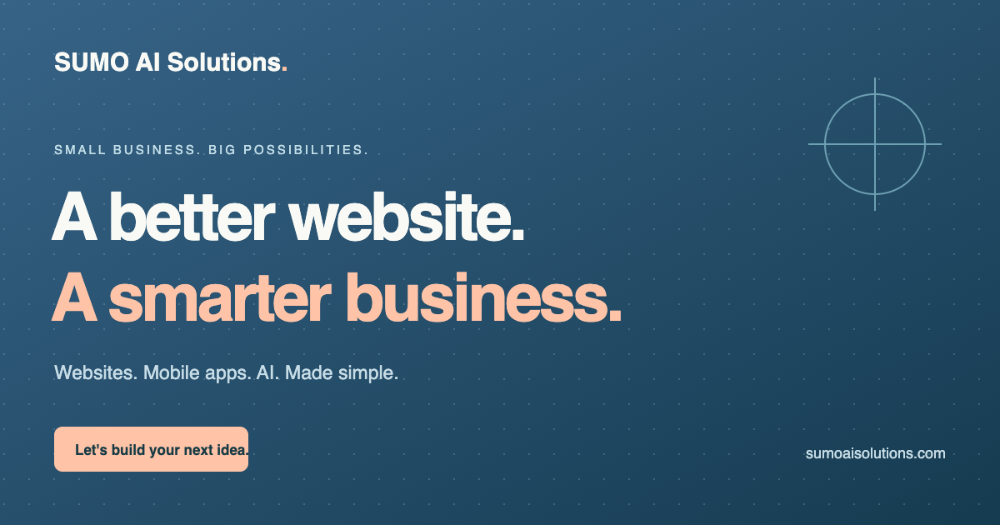

# SUMO AI Solutions



**Websites. Apps. AI. Made for you.**

We help small businesses get online, bring app ideas to life, and spend less time on repetitive work. Based in **Miami, Florida**, we work with clients everywhere.

[Visit our website](https://sumoaisolutions.com/) | [See our work](https://sumoaisolutions.com/portfolio/)

## What We Do

| Service | How we help |
| --- | --- |
| **Websites & web apps** | Business websites, landing pages, redesigns, online stores, booking and quote tools, and custom web apps. |
| **Mobile apps** | iPhone and Android apps for customers, teams, and new business ideas. |
| **AI for your business** | AI assistants that answer customer questions and practical AI tools for everyday work. |
| **Business automation** | Connected tools, automatic follow-ups, and less manual work. |
| **IT consulting & support** | Honest advice, troubleshooting, and hands-on implementation. |
| **Tech hiring help** | Defining roles and finding developers and IT specialists. |

## How We Work

1. **Tell us your idea.** A quick message about your business. No technical brief needed.
2. **Get a clear plan.** Scope, price, and timing agreed before any work starts.
3. **We build and launch.** You review along the way; we launch when you're happy.

## The Website

The site is built for people arriving from social ads, most of them on phones. It's designed to answer "what do you do, can I trust you, and how do I start?" within a few scrolls.

**Homepage sections**

| Section | Purpose |
| --- | --- |
| Header | The full SUMO AI Solutions wordmark, with Services, Portfolio, How it works, and Contact visible on desktop and mobile. |
| Hero + project showcase | Six real projects in a browser-and-phone presentation. Each opens a full-page image preview. Manual selection and a pause/resume control are available. |
| Services | Six clickable cards. Each opens the inquiry form with the topic pre-selected. |
| Portfolio | One compact link to the full gallery, without repeating hero project images. |
| How it works | Three-step process. |
| FAQ | Three short answers about cost, website improvements, and getting started. |
| Call to action | Final prompt to get in touch. |

The header remains available on phones. The lightweight dot field reacts to pointer movement and taps, with ambient movement on touch screens. Reduced-motion mode stops the canvas loop and automatic project rotation. Rotation also stops off screen or in a hidden tab.

**Portfolio** (`/portfolio/`) has filter chips (Home services, Restaurants, Real estate, Web apps), hover-to-scroll previews, full-page previews in a dialog, "Visit live site" links, and a "Build something similar" button on every project.

### Portfolio projects

| Project | Type | Live link |
| --- | --- | --- |
| The Fridge Repair | Home services, South Florida | https://www.thefridgerepair.com/ |
| Grill on Wheel | Restaurant, Hallandale Beach | https://lakviat.github.io/greelonwheel/ |
| Imperial Towers | Real estate (website concept) | https://lakviat.github.io/imperial_towers/ |
| Chi Cleaning Co. | Home services, Chicago | https://lakviat.github.io/chicago_cleaning_services-/ |
| Fast Image Converter | Web app | https://convertjpgs.com/ |
| JSON Diff | Web app | https://www.jsondiff.info/ |

Screenshots in `assets/portfolio/` were rendered from each project's own repository: `<id>.jpg` (desktop, 1200×750), `<id>-mobile.jpg` (390×844), and `<id>-full.jpg` (full page, used for hover-scroll and the preview dialog). Some third-party photos (such as stock images loaded from external hosts) don't appear in the renders, so a few full-page screenshots are cropped above those sections. Re-capture screenshots when a project's design changes. Check every live link before launching new ad campaigns.

## Website Setup

A build-free static website hosted on GitHub Pages. No application server or package installation is required.

| File | Purpose |
| --- | --- |
| `index.html` | Homepage, inquiry form, project preview dialog |
| `portfolio/index.html` | Project gallery with filters and previews |
| `style.css` | Shared design, responsive layouts, dialogs, reduced-motion rules |
| `script.js` | Project showcase, reactive dot field, filters, dialogs, scroll reveals, form submission, conversion event |
| `assets/icons.svg` | Shared icon sprite |
| `assets/portfolio/` | Project screenshots (desktop, mobile, full page) |
| `assets/fonts/` | Self-hosted Manrope font and its SIL Open Font License |
| `assets/social-preview.png` | Social sharing image; editable SVG source sits alongside it |
| `backend/consultation-handler.gs` | Google Apps Script backend for the inquiry form |
| `sitemap.xml`, `robots.txt` | Search-engine discovery |
| `indexnow-key.txt` | Public IndexNow domain-ownership challenge, not a secret |
| `scripts/submit-indexnow.cjs` | Notify participating search engines after the ownership file is live |
| `.github/workflows/search-discovery.yml` | Site checks and post-deployment IndexNow notifications |
| `CNAME` | Custom domain |
| `googlebb0f81e2e8e23f9a.html` | Google site verification |
| `tests/*.test.cjs` | Dependency-free structure, integration, and search-discovery checks |

### Brand

Cool blue backgrounds, translucent glass-style surfaces, white typography, and a restrained red signature inspired by the existing mark. Primary buttons use red `#c83533`; light red `#ff9390` is used for readable accent text. The favicon is unchanged. Type is self-hosted Manrope. Backdrop blur is limited to the header and open-dialog overlay; service cards use inexpensive translucent gradients.

### Local Preview

From the repository root:

```sh
python3 -m http.server 9090
```

Open [the homepage](http://localhost:9090/) or [the portfolio](http://localhost:9090/portfolio/).

### Checks

```sh
node --check script.js
node --check scripts/submit-indexnow.cjs
node --test tests/*.test.cjs
```

Also review desktop and mobile layouts, keyboard navigation (project selectors support arrow keys), reduced-motion mode, every consultation trigger, and every portfolio preview. Test the form with a mocked endpoint to avoid sending test emails or recording artificial ad conversions.

### Inquiry Form

Every consultation button, service card, and "Build something similar" button opens the same form. Buttons can pre-select an interest (website, mobile app, AI & automation, something else). The payload keeps all previous fields (`firstName`, `lastName`, `fullName`, `email`, `phone`, `message`, `projectDescription`, `attachments`, `source`, `pageUrl`, `interest`, `topic`). The chosen interest and starting point are also written at the top of `message`, so they show up in the existing email without backend changes.

### Preserved Integrations

- Google Ads base tag `AW-17948229197` on both public pages.
- Lead conversion `AW-17948229197/VZTvCKPwzogcEM38sO5C`, fired after a successful submission.
- Google Apps Script endpoint, attachment limits, and submission flow.
- Canonical URLs, structured data, sitemap, and Google verification file.

The site does not include a Meta Pixel. If you're running Instagram ads, adding the Meta Pixel (and a `Lead` event alongside the Google conversion) will let Meta optimize for form submissions. That needs the Pixel ID from Meta Events Manager.

### Deployment

Publish the repository root from `main` using the existing GitHub Pages configuration. Both HTML files use the same versioned CSS and JavaScript URLs (`?v=…`); update them together when changing shared assets.

### Search and AI Discoverability

The canonical site is **https://sumoaisolutions.com/**. The pages contain their text, metadata, and JSON-LD in the delivered HTML, without requiring JavaScript. `robots.txt` allows all crawlers, including Googlebot, bingbot, OpenAI's OAI-SearchBot, and other AI search crawlers. Keep public pages crawlable and snippets enabled; a crawler permission is not proof of indexing.

Titles, visible descriptions, and linked `Organization`, `WebSite`, `WebPage`, `Service`, and portfolio data describe the same business and content. Do not invent business addresses, reviews, or external `sameAs` profiles. Keyword tags are retained as brief service summaries, not a discovery mechanism: [Google does not use the keywords meta tag for indexing or ranking](https://developers.google.com/search/docs/crawling-indexing/special-tags#unsupported).

**Owner setup is still required.** A verification file, sitemap, or successful HTTP response alone does not confirm that a search engine has indexed the site.

| Platform | Required owner action |
| --- | --- |
| [Google Search Console](https://search.google.com/search-console/) | Add or open the exact `https://sumoaisolutions.com/` URL-prefix property, or verify the domain property through DNS. Preserve the existing Google verification HTML file. Submit `https://sumoaisolutions.com/sitemap.xml`, inspect both canonical page URLs, run the live test, and request indexing. Review Page indexing, Google's selected canonical, Manual actions, and Security issues for any reported exclusion. |
| [Bing Webmaster Tools](https://www.bing.com/webmasters/) | Verify the domain, or import an already verified Search Console property. Submit the same sitemap and inspect both URLs. Bing indexing also supports discovery in Microsoft search experiences; it does not guarantee a Copilot citation. |
| Business profiles and references | Link the canonical domain from genuine business/social profiles and relevant client credits where agreed. Keep the company name and location consistent. Only create a Google Business Profile or Bing Places listing if the business meets that platform's eligibility rules; do not invent a public office address. |
| AI search | Keep search crawlers allowed and useful business information visible. [Google AI Overviews and AI Mode use ordinary SEO requirements](https://developers.google.com/search/docs/appearance/ai-features), not a special AI text file or special schema. [OAI-SearchBot controls OpenAI search crawling](https://developers.openai.com/api/docs/bots); GPTBot training permissions are a separate setting. |

Use Search Console's Performance report to monitor impressions and clicks for the brand query `sumo ai solutions`. A public search result or `site:` query is not a complete indexing report. Recrawling can take days or longer, and neither rankings nor inclusion in any search engine or AI answer can be guaranteed.

**IndexNow notifications**

The `Search discovery` workflow checks pull requests and pushes to `main`. After a successful GitHub Pages `page_build` event in `lakviat/sumo_ai_solutions`, it checks the deployed ownership file and submits the sitemap's canonical URLs to [IndexNow](https://www.indexnow.org/documentation). Notifications are disabled for forks and pull requests. GitHub Actions must be enabled in the upstream repository.

`indexnow-key.txt` is a deliberately public ownership challenge, not an account credential. Keep it deployed at the root and do not rotate it on every run. Notifications help Bing and other participating engines discover updates; they do not submit URLs to Google or guarantee indexing. HTTP 202 means ownership verification is still pending, not that indexing succeeded. Missing or mismatched deployed keys and API failures fail the workflow visibly.

After deployment, the workflow can also be run manually from GitHub Actions. To send a notification locally with Node.js 24 or newer:

```sh
node scripts/submit-indexnow.cjs
```

When public content changes, update the corresponding sitemap `lastmod` to the actual modification date, never a future date or an automatically refreshed daily timestamp. Add new canonical pages to the sitemap and link them from existing pages.

## Start a Conversation

Use **Book a consultation** on [sumoaisolutions.com](https://sumoaisolutions.com/). Tell us what you're building, what needs improving, or where you could use a hand.
